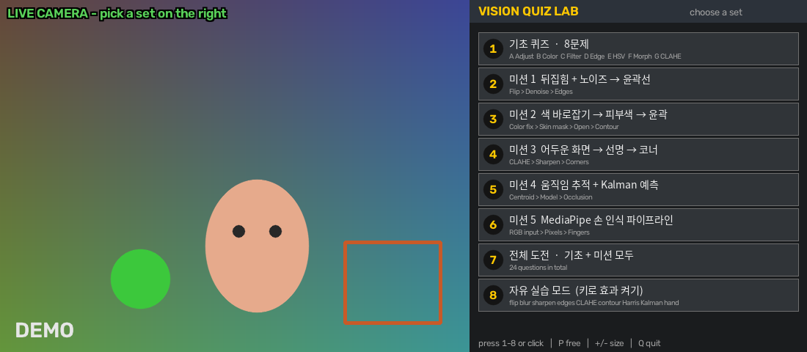
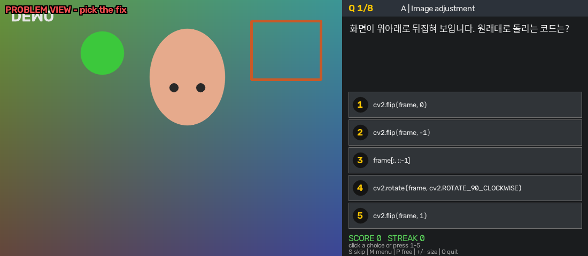
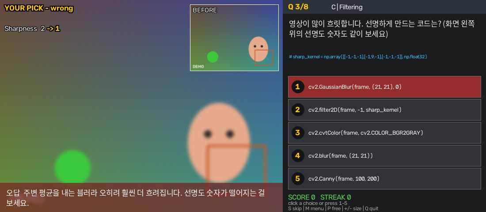
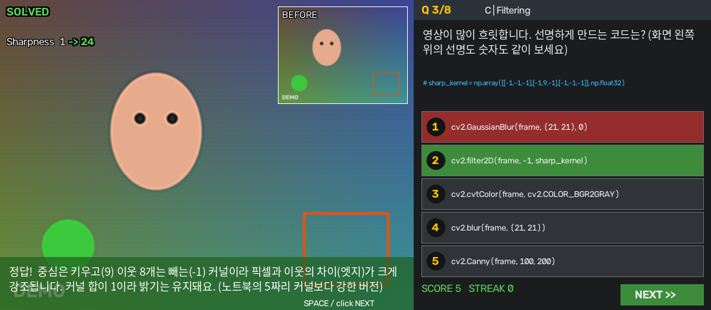
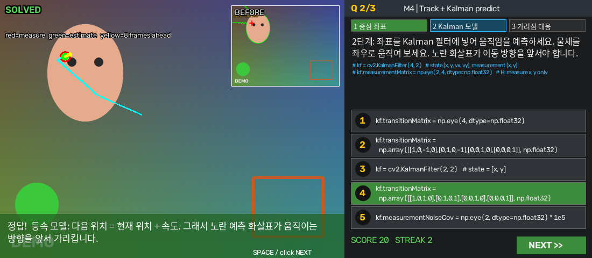

# Vision Quiz Lab (`06_03_jetson.py`)

카메라 영상을 **일부러 망가뜨려 놓고**, 오른쪽 패널의 5지선다 보기를 **클릭하면 그 OpenCV 코드가 실시간 영상에 바로 적용**되는 컴퓨터 비전 학습 퀴즈입니다.
Jetson(Ubuntu)의 USB 카메라로 `python 06_03_jetson.py` 한 줄이면 실행됩니다.

- 정답을 고르면 화면이 0.5초 동안 서서히 맑아지고 해설이 나옵니다. 미션의 마지막 단계를 맞히면 태그가 `MISSION CLEAR` 로 바뀝니다.
- 오답을 고르면 그 코드의 **잘못된 결과가 영상에 그대로** 보이고 이유가 나옵니다. 다시 고를 수 있습니다.
- 수업 Computer Vision 단원(노트북 A~G, M)의 개념을 "읽는" 대신 "내 얼굴에 적용해서 눈으로 확인"하며 복습하려고 만들었습니다.
- 퀴즈 안에서 AirBall(`05.py`, `06.py`)이 쓰는 MediaPipe 손 인식과 같은 개념(RGB 입력, 정규화 좌표, 관절 각도)도 다룹니다.

> 이 문서의 스크린샷은 실제 카메라가 아니라 `--demo` 가짜 영상으로 찍은 것입니다. 선명도 같은 숫자의 크기는 실제 카메라와 다릅니다.

---

## 목차

1. [빠른 시작](#1-빠른-시작)
2. [화면 구성](#2-화면-구성)
3. [사용법 (메뉴, 키, 옵션)](#3-사용법)
4. [무엇을 배우나: 문제 구성](#4-무엇을-배우나-문제-구성)
5. [동작 원리](#5-동작-원리)
6. [Jetson 카메라 파이프라인](#6-jetson-카메라-파이프라인)
7. [코드 구조](#7-코드-구조)
8. [설치와 환경](#8-설치와-환경)
9. [문제 해결](#9-문제-해결)
10. [검증 현황](#10-검증-현황)
11. [06_03.py 와 달라진 점](#11-06_03py-와-달라진-점)
12. [한계와 다음 계획](#12-한계와-다음-계획)

---

## 1. 빠른 시작

Jetson의 **데스크톱 터미널**(모니터가 연결된 쪽)에서 실행합니다.

```bash
git pull
cd ~/Documents/git/vision-LLM-<학번>/01_project     # 레포 폴더 이름은 본인 것
python 06_03_jetson.py                                # 옵션 없이 바로 실행 (USB 카메라 /dev/video0)
```

- 레포 루트에서 `python 01_project/06_03_jetson.py` 로 실행해도 됩니다. 손 모델은 현재 폴더, 이 파일이 있는 폴더, 그 한 단계 위(레포 루트)를 모두 찾고, 한글 폰트는 이 파일 옆과 시스템 폰트 폴더에서 찾기 때문입니다.
- `python` 명령이 없는 환경이면 `python3 06_03_jetson.py` 로 실행하세요. `05.py` / `06.py` 를 돌리는 것과 같은 Python 환경(OpenCV가 설치된 쪽)을 쓰면 됩니다.
- 시작하면 터미널에 아래와 같은 줄이 나옵니다 (창 배율 숫자는 화면 크기에 따라 다릅니다).

```text
[camera] GStreamer pipeline opened (USB /dev/video0)
[ui] Korean font: /usr/share/fonts/truetype/nanum/NanumGothic.ttf
[ui] window scale x1.70  (+ / - / 0 to change)
```

- 카메라 없이 화면과 클릭만 점검하려면 `python 06_03_jetson.py --demo` 를 씁니다.

---

## 2. 화면 구성

창은 **논리 캔버스 1100×480** 하나입니다. 왼쪽 640×480은 영상, 오른쪽 460×480은 패널입니다. 실제 창 크기는 화면 해상도에 맞춰 자동으로 키웁니다.

### 시작 메뉴



실행하면 메뉴가 뜹니다. 번호 키 `1`~`8` 또는 클릭으로 고릅니다. 왼쪽은 메뉴가 떠 있는 동안에도 라이브 카메라입니다.

### 문제 화면



- 왼쪽 위 빨간 글씨 `PROBLEM VIEW - pick the fix`: 아직 고르지 않았다는 뜻입니다. 미션이면 `STEP 2/3 - pick the fix` 처럼 나옵니다.
- 영상은 문제에 맞게 일부러 망가져 있습니다 (위아래 뒤집힘, 노이즈, 어두움 등).
- 오른쪽 패널: 문제 문장, (필요하면) 이미 실행된 코드 줄, 보기 5개. 보기 순서는 매번 섞입니다.
- 맨 아래: 점수(`SCORE`)와 연속 정답(`STREAK`).

### 오답을 골랐을 때



- 왼쪽 위 태그가 `YOUR PICK - wrong` 으로 바뀌고, 누른 보기가 **빨갛게** 표시됩니다.
- 영상에는 그 코드의 결과가 그대로 나옵니다 (여기서는 더 흐려졌습니다).
- 오른쪽 위 작은 `BEFORE` 화면은 보기를 적용하기 전 모습입니다. 전/후를 비교하라고 둔 것입니다.
- 왼쪽 위의 숫자(`Sharpness`, `Noise level`, `Contrast`)는 효과를 숫자로 보여 줍니다. 같은 보기를 눌러 본 뒤 다른 보기를 눌러 숫자를 비교해 보세요.
- 아래 배너에 왜 틀렸는지 이유가 나옵니다. 오답은 다시 고를 수 있습니다.

### 정답을 골랐을 때



- 태그가 `SOLVED`(초록)로 바뀌고, 문제 화면에서 결과 화면으로 0.5초 동안 크로스페이드됩니다.
- 정답 보기는 **초록**으로 표시되고 해설 배너와 `NEXT >>` 버튼이 나옵니다 (`SPACE`/`ENTER`/클릭).

### 단계 미션 (Kalman 예시)



- 미션은 여러 단계로 이어집니다. 위쪽 탭(`1 중심 좌표`, `2 Kalman 모델`, `3 가려짐 대응`)이 단계 진행을 보여 줍니다.
- **앞 단계의 정답 결과가 다음 단계의 입력**이 됩니다. 여기서는 1단계에서 구한 중심 좌표가 Kalman 필터의 측정값으로 들어갑니다.
- 화면 안내문(`red=measure green=estimate yellow=8 frames ahead`) 그대로, 빨간 원은 측정값, 초록 점은 필터 추정값, 노란 화살표는 8프레임 뒤 예측 위치입니다. 하늘색 선은 최근 추정 위치의 궤적입니다.

---

## 3. 사용법

### 메뉴

| 키 | 세트 | 내용 |
|---|---|---|
| `1` | 기초 퀴즈 | 8문제 (노트북 A~G단원) |
| `2` | 미션 1 | 뒤집힘 + 노이즈 → 윤곽선 |
| `3` | 미션 2 | 색 바로잡기 → 피부색 → 윤곽 |
| `4` | 미션 3 | 어두운 화면 → 선명 → 코너 |
| `5` | 미션 4 | 움직임 추적 + Kalman 예측 |
| `6` | 미션 5 | MediaPipe 손 인식 파이프라인 (손 모델 파일 필요) |
| `7` | 전체 도전 | 기초 + 미션 전부 |
| `8` | 자유 실습 | 퀴즈 없이 키로 효과 켜 보기 |

### 조작 키

| 상황 | 키 | 동작 |
|---|---|---|
| 메뉴 | `1`~`8` 또는 클릭 | 세트 선택 |
| 퀴즈 | `1`~`5` 또는 클릭 | 보기 선택 |
| 퀴즈 | `SPACE` / `ENTER` | 정답 뒤 다음 문제 |
| 퀴즈 | `S` | 건너뛰기 (0점) |
| 퀴즈 / 결과 | `M` | 메뉴로 |
| 결과 화면 | `R` / `W` | 처음부터 다시 / 첫 시도에 못 맞힌 문제만 다시 |
| 공통 | `P` | 퀴즈 ↔ 자유 실습 전환 |
| 공통 | `+` `-` `0` | 창 크기 키우기 / 줄이기 / 자동 크기 |
| 공통 | `Q` / `ESC` | 종료 |

### 자유 실습 모드 키

| 키 | 효과 | 키 | 효과 |
|---|---|---|---|
| `1` | 반전 (좌우 / 상하 / 둘 다) | `8` | CLAHE |
| `2` | 흑백 | `9` | 색 분할 (피부 / 초록 / 주황 / 빨강 / 파랑) |
| `3` | HSV 채널 (H / S / V) | `M` | 모폴로지 (OPEN → CLOSE) |
| `4` | box 블러 | `C` | 윤곽선 + 중심 |
| `5` | Gaussian 블러 | `H` | Harris 코너 |
| `6` | 샤프닝 (커널 3종) | `K` | Kalman 추적 |
| `7` | 엣지 (Sobel / Canny) | `T` | Kalman 대상 (색 덩어리 ↔ 검지 끝) |
| `[` `]` | 선택된 파라미터 조절 | `G` | 손 인식 (MediaPipe) |
| `R` | 모두 초기화 | `V` | 원본 PIP 보기 |

패널의 `CODE RUNNING:` 에 **지금 실행 중인 코드가 한 줄씩** 표시됩니다. 키를 누르는 것과 코드의 대응을 눈으로 볼 수 있습니다.
효과는 반전 → 흑백 → HSV 채널 → box 블러 → Gaussian 블러 → 샤프닝 → CLAHE → 엣지 → 색 분할 → 윤곽 → Harris → 손 인식 → Kalman 순으로 앞의 결과가 뒤의 입력이 됩니다.

### 실행 옵션

| 옵션 | 설명 |
|---|---|
| (없음) | USB 카메라 `/dev/video0` 를 GStreamer 파이프라인으로 열기 |
| `--demo` | 카메라 없이 가짜 영상으로 실행 |
| `--video a.mp4` | 영상 파일로 실행 (끝나면 처음부터 반복) |
| `--image a.png` | 이미지 한 장으로 실행 |
| `--csi` | Jetson CSI(리본 케이블) 카메라 `nvarguscamerasrc` (이 파이프라인은 검증 전) |
| `--set m2` | 메뉴를 건너뛰고 바로 시작: `basic` / `missions` / `all` / `m1`~`m5` |
| `--mode free` | 자유 실습 모드로 시작 |
| `--scale 1.6` | 창 크기 배율 직접 지정 (기본: 화면에 맞춰 자동) |
| `--lang en` | 영어 UI 강제 (한글 폰트가 없으면 자동으로 영어) |
| `--seed 3` | 보기 순서를 고정 (같은 값이면 같은 순서) |
| `--hand-model PATH` | `hand_landmarker.task` 경로 직접 지정 |

---

## 4. 무엇을 배우나: 문제 구성

### 기초 퀴즈 8문제

각 문제의 오답은 "학생이 자주 하는 실수"와 "효과는 있지만 목적과 다른 함수"로 만들었습니다.

| # | 단원 | 문제 상황 | 정답 | 대표적인 함정 |
|---|---|---|---|---|
| 1 | A 영상 조정 | 화면이 위아래로 뒤집힘 | `cv2.flip(frame, 0)` | flipCode 1 / -1 혼동, NumPy 슬라이싱, 90도 회전 |
| 2 | B 색공간 | 피부가 파랗게 보임 (B, R 뒤바뀜) | `cv2.cvtColor(frame, cv2.COLOR_BGR2RGB)` | GRAY / HSV / LAB 변환은 색을 고치지 못함 |
| 3 | C 필터링 | 영상이 흐릿함 | `cv2.filter2D(frame, -1, sharp_kernel)` | 블러는 더 흐려짐, Canny는 윤곽만 남김 |
| 4 | C 필터링 | 노이즈가 자글자글함 | `cv2.GaussianBlur(frame, (9, 9), 0)` | 샤프닝은 노이즈까지 증폭 |
| 5 | D 엣지 | 경계선만 뽑기 | `cv2.Canny(gray, 100, 200)` | float32 입력은 에러 (uint8 전용) |
| 6 | E 색 분할 | 피부색만 남기기 | `cv2.inRange(hsv, (0, 40, 70), (20, 255, 255))` | BGR 값에 HSV 범위를 쓰는 실수 |
| 7 | F 모폴로지 | 마스크의 작은 흰 점 제거 | `cv2.morphologyEx(mask, cv2.MORPH_OPEN, kernel)` | CLOSE는 구멍 메우기, dilate는 점이 더 커짐 |
| 8 | G 영상 개선 | 어둡고 뿌옇다 | LAB의 L 채널에만 CLAHE 적용 | BGR 채널을 따로 평활화하면 색이 틀어짐 |

### 단계 미션 5개 (총 16단계)

앞 단계의 **정답 결과가 다음 단계의 입력**이 되는 파이프라인 문제입니다. 오답을 눌러 본 결과는 다음 단계로 넘어가지 않습니다.

| 미션 | 이름 | 단계 (정답 코드) |
|---|---|---|
| 1 | 뒤집힘 + 노이즈 → 윤곽선 | ① `cv2.flip(frame, 0)` → ② `GaussianBlur(frame, (9, 9), 0)` → ③ `Canny(gray, 100, 200)` |
| 2 | 색 바로잡기 → 피부색 → 윤곽 | ① `BGR2RGB` → ② `inRange(hsv, (0, 40, 70), (20, 255, 255))` → ③ `MORPH_OPEN` → ④ `cnt = max(contours, key=cv2.contourArea)` (가장 큰 윤곽의 테두리와 중심점 표시) |
| 3 | 어두운 화면 → 선명 → 코너 | ① L 채널 CLAHE → ② `filter2D` 샤프닝 → ③ Harris `frame[dst > 0.01 * dst.max()] = (0, 0, 255)` |
| 4 | 움직임 추적 + Kalman 예측 | ① `moments` 중심 좌표 `M["m10"] / M["m00"]` → ② 등속도 전이 행렬 `transitionMatrix` → ③ 측정이 없을 때 `kf.predict()` 결과만 사용 |
| 5 | MediaPipe 손 인식 | ① `BGR2RGB` 입력 → ② `(int(p.x * w), int(p.y * h))` 픽셀 변환 → ③ 관절 각도 `angle >= 160` 이면 펴짐 |

- 미션 5는 **손 모델 파일(`hand_landmarker.task`)과 `mediapipe` 가 있어야** 열립니다. 없으면 메뉴의 미션 5 항목이 어둡게 표시되고 빨간 글씨로 `needs: …` 사유가 나옵니다. `전체 도전`에서는 미션 5만 빠집니다.
- 미션을 끝내면 정답 보기를 이어 붙인 **완성 코드**가 결과 화면과 터미널(`[MISSION n CLEAR]`)에 나옵니다.

### 점수

| 상황 | 점수 |
|---|---|
| 첫 시도에 정답 | 10점 (연속 정답 `STREAK` +1) |
| 한 번 틀리고 정답 | 5점 |
| 두 번 이상 틀리고 정답 | 0점 |
| `S` 로 건너뛰기 | 0점 (연속 정답 끊김) |

---

## 5. 동작 원리

### 한 프레임이 화면에 나오기까지

```text
카메라 프레임 (FrameSource.read -> fit_frame: 4:3 중앙 크롭 후 640x480 BGR)
  -> 문제 화면: 기초 문제는 p_* 함수로 망가뜨림 / 미션은 앞 단계 정답을 차례로 적용
  -> 보기를 골랐으면 그 보기의 함수 실행 (예외가 나도 죽지 않고 ERROR 문구 표시)
  -> to_view(): 어떤 결과든 640x480 BGR uint8 로 통일
  -> 오른쪽 패널(460x480)을 붙여 1100x480 논리 캔버스 완성
  -> App.present(): 배율(scale)을 곱해서 cv2.imshow
```

### 설계 포인트

| 주제 | 방식 | 이유 |
|---|---|---|
| 논리 캔버스 | 모든 그리기와 버튼 좌표를 1100×480 기준으로 하고 마지막에 확대 | 해상도가 달라도 레이아웃 코드가 한 벌. 마우스 좌표는 배율로 나눠 되돌림 |
| 입력 통일 | `fit_frame()` 이 어떤 해상도든 640×480으로 맞춤 | 모든 좌표 계산을 640×480 기준으로 안전하게 |
| 오답 결과 보여 주기 | `to_view()` 가 흑백, 마스크, 다른 크기도 BGR로 통일 | 오답 코드가 이상한 결과를 내도 프로그램이 죽지 않고 그대로 보여 줌 |
| 미션 파이프라인 | `Quiz._stage_input()` 이 매 프레임 `원본 → 앞 단계 정답들` 을 다시 계산 | 카메라가 움직여도 항상 새 프레임으로 이어서 계산 |
| 효과를 숫자로 | `metric_sharp` (Laplacian 분산), `metric_noise` (Immerkaer), `metric_contrast` (밝기 표준편차) | 눈으로 구분이 애매한 차이를 숫자로 확인 |
| 지연 로딩 | MediaPipe는 미션 5나 손 모드를 처음 열 때만 불러옴 | 시작이 느려지지 않고, 없어도 프로그램은 계속 동작 |
| 노이즈 패턴 풀 | 노이즈를 6장 미리 만들어 프레임마다 무작위로 하나 사용 | 매 프레임 난수를 새로 만들면 느림 |
| 글자 맞춤 | `fit_lines()` 가 픽셀 폭을 재서 줄바꿈 | OpenCV 4.x와 5.x는 글자 폭이 달라서 글자 수로 자르면 넘침 |
| 한글 | Pillow로 문제가 바뀔 때만 그려서 캐시 | `cv2.putText` 는 한글을 못 그리고, 매 프레임 그리면 느림 |

---

## 6. Jetson 카메라 파이프라인

`05.py`, `06.py` 와 **같은 파이프라인 문자열**을 그대로 씁니다 (내용은 한 글자도 바꾸지 않았습니다. 따옴표만 `06.py` 처럼 작은따옴표로 썼습니다).

```python
pipeline = (
    'v4l2src device=/dev/video0 ! '
    'video/x-raw,format=YUY2,width=640,height=480,framerate=30/1 ! '
    'videoconvert ! video/x-raw,format=BGR ! '
    'queue leaky=downstream max-size-buffers=1 '
    'max-size-bytes=0 max-size-time=0 ! '
    'appsink drop=true max-buffers=1 sync=false'
)
cap = cv2.VideoCapture(pipeline, cv2.CAP_GSTREAMER)
```

| 요소 | 하는 일 |
|---|---|
| `v4l2src device=/dev/video0` | USB 카메라(V4L2 장치 `/dev/video0`)에서 프레임을 받는다 |
| `video/x-raw,format=YUY2,width=640,height=480,framerate=30/1` | 카메라가 내보내는 형식: YUY2, 640×480, 30fps |
| `videoconvert ! video/x-raw,format=BGR` | YUY2를 BGR로 변환 (OpenCV가 쓰는 채널 순서) |
| `queue leaky=downstream max-size-buffers=1 max-size-bytes=0 max-size-time=0` | 큐가 차면 오래된 프레임을 버린다. 버퍼는 1장 (`0` = 바이트·시간 제한 없음) |
| `appsink drop=true max-buffers=1 sync=false` | OpenCV가 가져가는 출구. 항상 **가장 최신 1장**만 유지하고 시계 동기화는 하지 않는다 |

핵심은 `drop=true max-buffers=1` 입니다. 처리가 느려도 프레임이 쌓이지 않아서 **화면이 점점 밀리는(지연 누적) 현상**이 없습니다.

카메라가 안 열리면 `camera_help()` 가 원인 후보를 터미널에 알려 줍니다 ([문제 해결](#9-문제-해결) 참고).

---

## 7. 코드 구조

`06_03_jetson.py` 는 한 파일이고 위에서 아래로 "입력 → 효과 → 문제 → 엔진 → 화면" 순서입니다. 파일 맨 위에 읽는 방법과 OpenCV/NumPy 치트시트가 주석으로 들어 있습니다.

| 구역 | 내용 | 먼저 볼 이름 |
|---|---|---|
| 0. 상수 | 화면 크기, 색, 샤프닝 커널, 피부색 HSV 범위, 손 관절 번호, GStreamer 파이프라인 | `VID_W`, `PANEL_W`, `SKIN_LO/HI`, `ANGLE_THRESHOLD`, `GST_USB` |
| 1. 공통 유틸 | 글씨 그리기, 크기·형식 통일, 한글 렌더러 | `to_view`, `fit_frame`, `fit_lines`, `TextRenderer` |
| 2. 카메라 입력 | 카메라 / 영상 / 이미지 / 가짜 영상을 한 곳에서 | `FrameSource`, `camera_help` |
| 3. 효과 함수 | `p_*` 망가뜨리기, `s_*` 보기, 숫자 지표 3개 | `p_flip_ud`, `s_sharp`, `metric_sharp` |
| 4. 문제 은행 | 기초 8문제 (문장, 보기 5개, 정답, 해설) | `build_questions` |
| 4b. 단계 미션 | 미션 5개, 16단계, 완성 코드 | `build_missions`, `kalman_frame` |
| 5. 퀴즈 엔진 | 메뉴 / 문제 / 정답 / 요약 상태 머신, 그리기, 입력 | `Quiz.pick`, `Quiz._video`, `Quiz._stage_input` |
| 6. 손 인식 | MediaPipe 래퍼, 관절 각도 계산 | `HandTracker`, `calculate_angle` |
| 7. 자유 실습 | 키 하나 = 효과 하나 | `FreePlay` |
| 8. 앱 / 메인 | 창, 배율, 마우스 콜백, 메인 루프, 옵션 | `App`, `main`, `check_display` |

퀴즈 상태는 `menu → ask → solved → (다음 문제 ask …) → summary` 로 흐릅니다. 오답은 `ask` 에 그대로 머물러서 다시 고를 수 있습니다.

---

## 8. 설치와 환경

| 항목 | 필요 | 비고 |
|---|---|---|
| Python | 3.8 이상 | 문법은 3.8 규칙으로 파싱되는 것을 확인했습니다. 실제 실행은 3.13(개발 환경)과 3.11(Windows)에서 확인했고, Jetson의 Python 버전에서는 아직 실행하지 않았습니다 |
| OpenCV | **GStreamer 지원 빌드** | `05.py` / `06.py` 가 돌아가는 같은 환경이면 됨. JetPack에 포함된 OpenCV는 보통 GStreamer가 켜져 있음 |
| NumPy | 필수 | |
| Pillow | 권장 | 한글 표시용. 없으면 영어 UI |
| mediapipe | 선택 | 미션 5, 자유 실습의 손 인식과 Kalman 손가락 추적 |
| 한글 폰트 | 권장 | `sudo apt install fonts-nanum`, 또는 이 파일 옆에 `ko_font.ttf` |
| 손 모델 | 선택 | `<레포 루트>/src/models/MediaPipe/hand_landmarker.task` (`05.py` / `06.py` 와 같은 위치) |

확인 명령:

```bash
python3 -c "import cv2; print(cv2.__version__)"
python3 -c "import cv2, re; print(re.search(r'GStreamer:\s*\S+', cv2.getBuildInformation()).group(0))"   # GStreamer: YES 여야 함
ls ../src/models/MediaPipe/hand_landmarker.task                                                          # 01_project 안에서
fc-list :lang=ko | head -3                                                                               # 한글 폰트가 있는지
```

손 모델 탐색 순서: `--hand-model` 경로 → 현재 폴더 기준 `src/models/MediaPipe/…` → 이 파일 기준 → 이 파일 한 단계 위(레포 루트) → 이 파일 옆의 `hand_landmarker.task`.

---

## 9. 문제 해결

| 증상 | 원인 | 해결 |
|---|---|---|
| `[error] 카메라를 열지 못했습니다 …` | `/dev/video0` 없음, OpenCV에 GStreamer 없음, 다른 프로그램이 카메라 사용 | 메시지에 나온 순서대로 확인: `ls /dev/video*`, 위의 `GStreamer: YES` 확인, `05.py` / `06.py` 종료. `v4l2-ctl --list-devices` 와 `gst-launch-1.0 v4l2src device=/dev/video0 ! videoconvert ! autovideosink` 로 카메라만 따로 시험 |
| `[error] 화면(DISPLAY)을 찾을 수 없어 …` | SSH로 접속해서 모니터 연결 정보가 없음 | Jetson 데스크톱의 터미널에서 실행하거나, SSH에서 `export DISPLAY=:0` 입력 후 실행 |
| `[camera] no frame yet` 뒤 종료 | 카메라는 열렸지만 프레임이 안 들어옴 (케이블, 점유) | 케이블을 다시 연결하고, 다른 프로그램을 종료. 처음 약 3초는 기다려 줌 |
| 글자가 전부 영어 | 한글 폰트를 못 찾음 (`[ui] Korean font: not found`) | `sudo apt install fonts-nanum` |
| 메뉴에서 미션 5가 어둡고 `needs: …` 가 보임 | `mediapipe` 미설치 또는 `hand_landmarker.task` 없음 | 빨간 작은 글씨에 이유가 나옴. 모델 위치와 패키지 확인 |
| 창이 화면보다 크거나 작음 | 화면 해상도를 못 읽었거나 취향 차이 | `+` / `-` / `0` 키, 또는 `--scale 1.2` |
| 느리다 | 큰 창 배율, MediaPipe 사용 중 | `-` 키로 배율을 낮추고, 손 기능을 끄기 |

---

## 10. 검증 현황

### 개발 환경(x86_64 Linux)에서 확인한 것

- Python 3.8 문법 규칙으로 파싱됨(`ast`, 문법만 확인), `pyflakes` 경고 없음.
- OpenCV **5.0.0 과 4.14.0 모두**에서 같은 결과: 기초 8문제와 미션 16단계의 모든 보기가 실제로 실행되고, 정답은 정답, 오답은 의도한 오답 결과를 내는지 확인.
- 글자 넘침 검사: 모든 보기 코드, 이미 실행된 코드 줄, 해설 배너, 미션 완성 코드가 영역 안에 들어감 (OpenCV 4/5의 글자 폭 차이 포함).
- `filter2D`, `KalmanFilter` 에 넘기는 행렬이 `np.float32` 배열이라 에러가 없음을 코드를 실제로 실행해 확인.
- 카메라 열기: 파이프라인 문자열이 위 6장의 것과 글자 단위로 같고, `cv2.VideoCapture(pipeline, cv2.CAP_GSTREAMER)` 로 호출되는지 가짜 `VideoCapture` 로 확인.
- 프레임 읽기 실패 후 복구 / 계속 실패 시 종료, `DISPLAY` 검사, `xrandr` 출력 파싱, 손 모델 경로 탐색(`01_project` 안 / 레포 루트 / 다른 폴더)을 시험.
- 가상 화면(Xvfb)에서 실제 창을 띄워 문제 화면, 보기, 한글 글씨가 나오는 것을 확인.

### Jetson에서 직접 확인할 것

개발 환경에는 Jetson 카메라와 GStreamer 장치가 없어서 아래는 **아직 확인하지 못했습니다.** 실행한 뒤 체크하세요.

- [ ] USB 카메라가 열리고 영상이 나온다 (`[camera] GStreamer pipeline opened`)
- [ ] 창이 화면 크기에 맞게 열린다 (자동 배율): `x____`
- [ ] 한글이 나온다 (`[ui] Korean font:` 에 경로가 나옴)
- [ ] 클릭과 키 입력이 동작한다
- [ ] FPS (화면 왼쪽 위 숫자): ____ FPS
- [ ] 미션 5 (손 인식)가 열리고 손이 검출된다 — 모델 파일 필요
- [ ] (선택) `--csi` CSI 카메라

---

## 11. `06_03.py` 와 달라진 점

퀴즈 내용과 화면은 같고, 입출력만 Jetson에 맞게 바꾼 버전입니다.

| 항목 | `06_03.py` | `06_03_jetson.py` |
|---|---|---|
| 카메라 | Windows 웹캠(DirectShow) / Jetson 자동 선택, `--cam N` `--gst` 옵션 | **GStreamer USB 파이프라인 고정**, 옵션 없이 실행. `--cam` `--gst` 는 없앰 (`--csi` 는 유지) |
| 창 크기 | `tkinter` 로 해상도 읽기, 모르면 1.5배 | `xrandr` 로 읽기(없으면 `xdpyinfo`, `tkinter`), 모르면 1.0배 |
| 프레임 읽기 실패 | 한 번 실패하면 바로 종료 | 약 3초(실패 100회) 기다린 뒤 종료. 기다리는 동안에도 `Q` / `ESC` 가능 |
| 오류 안내 | 짧은 메시지 | 카메라 실패 원인 후보, `DISPLAY` 없음 안내 |
| 창 제목 | `(06_03)` | `(06_03 Jetson)` |

퀴즈 내용(문제, 보기, 해설, 점수), 자유 실습, 손 모델 탐색 순서는 두 파일이 같습니다.

---

## 12. 한계와 다음 계획

- 손 인식의 실제 검출은 Jetson에서 직접 확인이 필요합니다. 모델 파일이 없는 환경에서는 가짜 랜드마크로만 검증했습니다.
- 피부색 HSV 범위(`H 0~20, S ≥ 40, V ≥ 70`)는 조명과 피부톤에 따라 달라지는 **출발점**입니다. 나무색, 베이지색 배경이 같이 잡힐 수 있습니다.
- 보기는 객관식뿐이라 코드를 직접 입력해 보지는 못합니다.
- 다음에 해 볼 것 (아이디어): 화면 안에서 한 줄 코드를 직접 입력하는 콘솔, 정답을 직접 입력하는 주관식 모드, 저장한 코드 파일을 다시 읽어 적용하는 핫 리로드.

## 파일 위치

```text
vision-LLM-<학번>/
├── 01_project/
│   ├── 05.py
│   ├── 06.py
│   ├── 06_03_jetson.py          <- 이 앱
│   ├── README_06_03_jetson.md   <- 이 문서
│   └── readme_images/           <- 이 문서의 스크린샷
└── src/models/MediaPipe/
    └── hand_landmarker.task     <- 손 모델 (미션 5, 손 인식)
```
