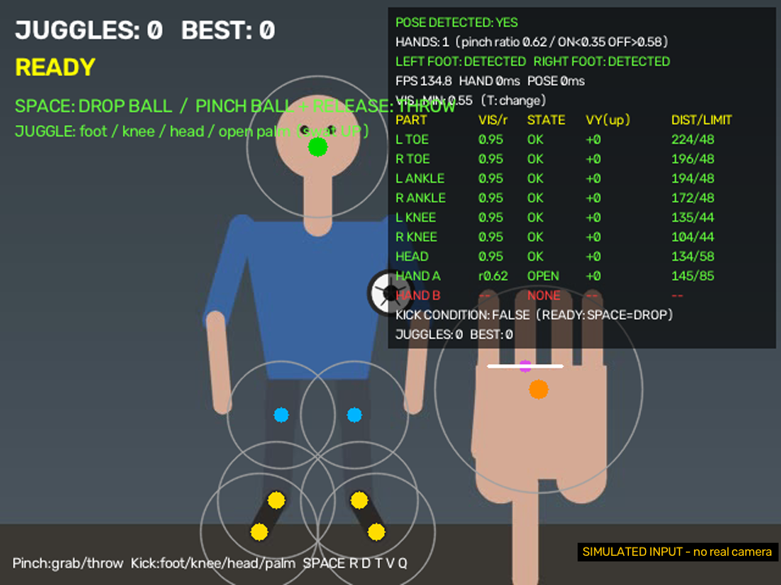
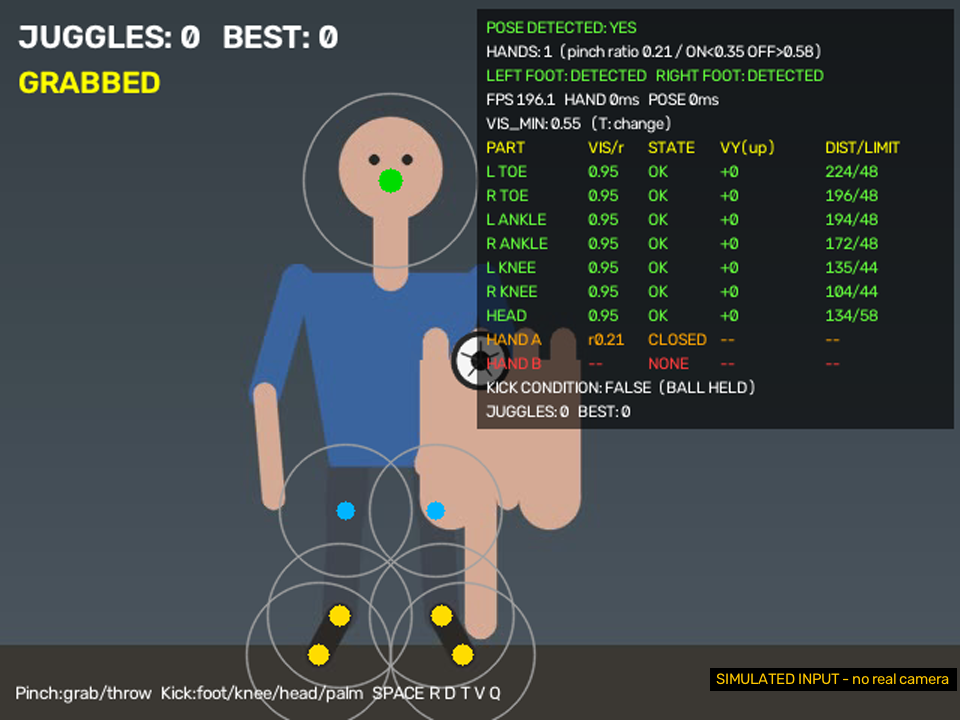
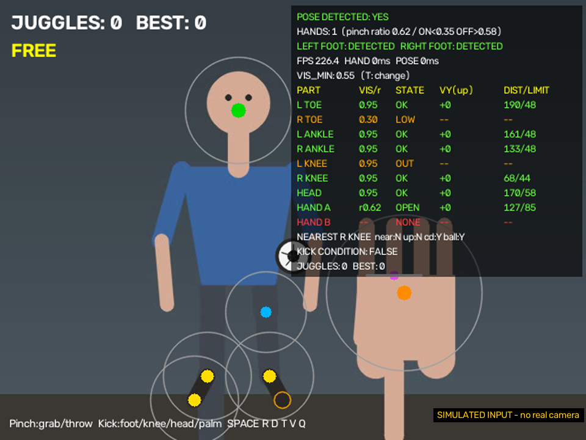
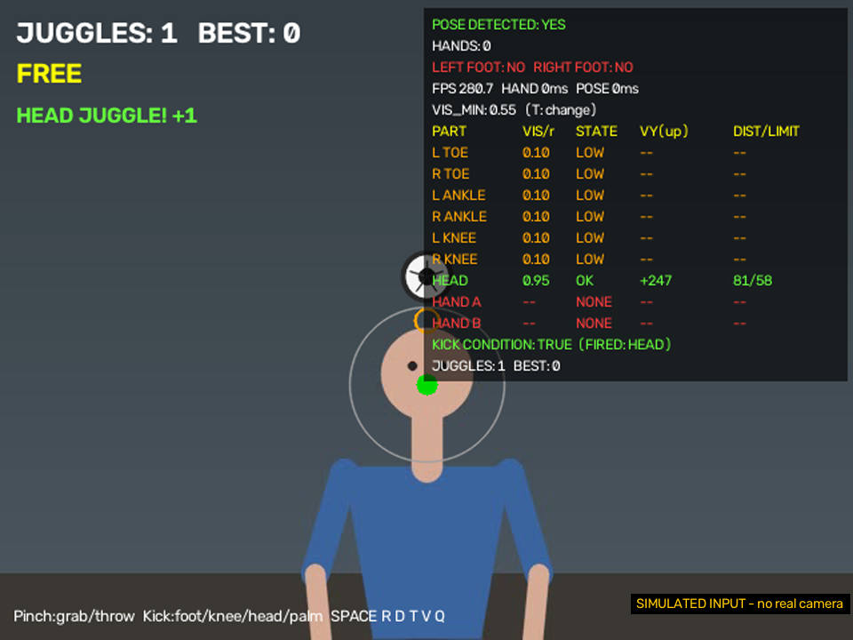
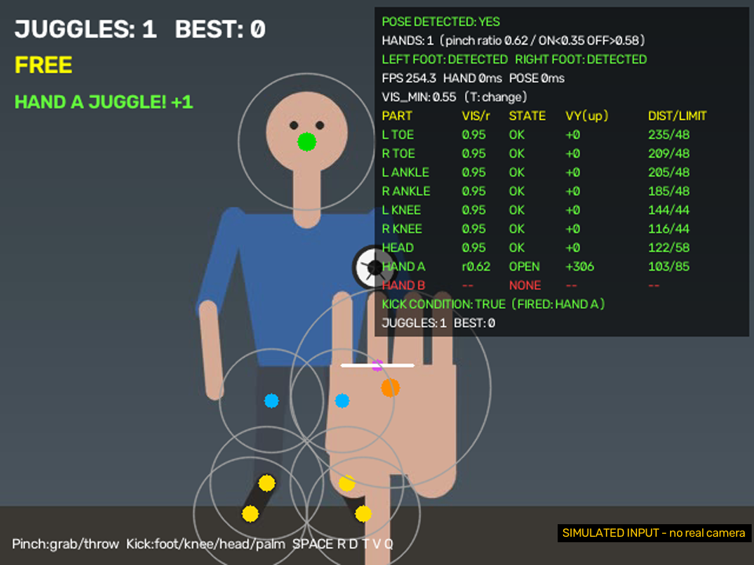
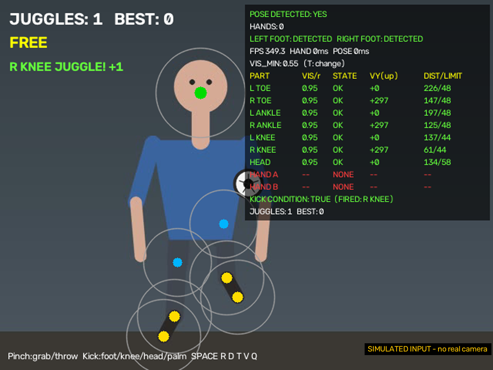

# AirBall Football (`06_02_jetson.py`)

웹캠 앞에서 **손으로 공을 잡아 던지고, 발·무릎·머리·손바닥으로 공을 쳐올려 저글링**하는 2D 프로토타입입니다.
MediaPipe의 손(Hand)과 몸(Pose) 랜드마크로 내 몸의 위치를 읽고, 공의 움직임(중력, 튕김, 충돌)은 직접 계산합니다.

- `06_02.py` 는 `06_01.py` 에 **머리 저글링**과 **손바닥 저글링** 두 가지를 더한 버전입니다. 나머지는 `06_01.py` 와 같습니다.
- Jetson(USB 카메라, GStreamer)과 Windows 노트북 웹캠을 모두 지원하고, 녹화 영상으로 **재생 테스트**와 **디버그 패널**이 들어 있습니다.

> 이 문서는 코드를 읽고 쓴 설명서입니다. 실제 카메라와 모델로 동작시킨 결과는 [검증 현황](#10-검증-현황)에 체크박스로 남겼으니 직접 확인해 주세요.

---

## 목차

1. [빠른 시작](#1-빠른-시작)
2. [게임 방법과 조작](#2-게임-방법과-조작)
3. [실행 옵션](#3-실행-옵션)
4. [모델 파일 받기](#4-모델-파일-받기)
5. [동작 원리](#5-동작-원리)
6. [디버그 패널 읽는 법](#6-디버그-패널-읽는-법)
7. [녹화와 재생](#7-녹화와-재생)
8. [튜닝 가이드](#8-튜닝-가이드)
9. [문제 해결](#9-문제-해결)
10. [검증 현황](#10-검증-현황)
11. [06_02 에서 달라진 점](#11-06_02-에서-달라진-점)

---

## 1. 빠른 시작

```bash
# Jetson (USB 카메라 /dev/video0, 모니터 연결된 터미널)
cd ~/Documents/git/vision-LLM-<학번>
python3 01_project/06_02.py

# Windows 노트북 (웹캠 자동 사용)
cd C:\Users\<이름>\Vision-LLM-<학번>
python 01_project\06_02.py
```

- 모델 파일 위치는 **이 파일 기준으로 저장소 루트를 계산**해서 찾습니다(`REPO_ROOT = 이 파일의 부모의 부모`). 그래서 어느 폴더에서 실행해도 되지만, 저장소 루트에서 실행하는 것을 권장합니다.
- 처음에는 모델 파일 2개가 `src/models/MediaPipe/` 에 있어야 합니다. 없으면 받는 명령을 알려 주고 종료합니다 → [4. 모델 파일 받기](#4-모델-파일-받기)
- 시작하면 공이 화면 가운데 **떠 있는 대기(READY) 상태**입니다. `SPACE` 를 누르면 공이 떨어지기 시작합니다.

---

## 2. 게임 방법과 조작

화면은 **거울처럼 좌우 반전**되어 있어서 내가 오른손을 들면 화면에서도 오른쪽에 보입니다.

### 공을 다루는 방법

| 동작 | 방법 |
|---|---|
| **잡기** | 엄지와 검지를 **붙여서(핀치)** 공 가까이에 가져가면 공이 손에 붙습니다 (`GRABBED`) |
| **던지기** | 핀치를 **풀면서** 손을 움직이면 그 속도로 공이 날아갑니다 |
| **발 / 무릎 / 머리** | 그 부위를 공 가까이에서 **위로 쳐올리면** 공이 튕겨 오르고 `JUGGLES` 가 1 올라갑니다 |
| **손바닥** | **엄지와 검지를 벌려 손을 편 채로**, 공 아래에서 손을 위로 쳐올립니다 (엄지-검지를 붙이면 핀치=잡기로 인식됨) |
| **실패** | 공이 바닥에 닿으면 점수가 `BEST` 에 반영되고 대기 상태로 돌아갑니다 |

"공에 닿았다"가 아니라 **"그 부위가 위로 움직였다"** 가 조건입니다. 가만히 있는 머리에 공이 맞아도 튕기지 않습니다.

### 키

키는 **영문 소문자 입력 상태**에서만 동작합니다 (대문자, 한글 입력 상태에서는 반응하지 않습니다).

| 키 | 동작 |
|---|---|
| `SPACE` | 대기 상태의 공을 떨어뜨리기 (시작) |
| `r` | 공과 점수를 초기화 (다시 대기 상태) |
| `d` | 디버그 패널 켜기 / 끄기 |
| `t` | 발·무릎·머리 visibility 임계값 순환 (0.55 → 0.40 → 0.30 → 0.20 → 0.55) |
| `v` | 녹화 시작 / 종료 |
| `q` | 종료 |

### 화면에 보이는 것

| 표시 | 의미 |
|---|---|
| `JUGGLES: n  BEST: m` | 이번 판 저글링 수 / 최고 기록 |
| `READY` / `FREE` / `GRABBED` | 공이 대기 중 / 자유롭게 움직이는 중 / 손에 잡힌 중 |
| 노란 점 / 파란 점 / 초록 점 / 주황 점 | 발 / 무릎 / 머리 / 손바닥 (BGR 색 지정 기준: 발 `(0,220,255)`, 무릎 `(255,180,0)`, 머리 `(0,220,0)`, 손바닥 `(0,140,255)`) |
| 보라 점 + 흰 선 | 손의 엄지-검지 중점과 그 연결선 (핀치 상태 확인용) |
| 오른쪽 위 표 | [디버그 패널](#6-디버그-패널-읽는-법) |

### 화면 예시

> **아래 화면은 실제 카메라로 찍은 것이 아닙니다.** 사람은 도형으로 그려 넣은 영상이고, 손과 몸의 위치는 같은 좌표의 가짜 MediaPipe 결과로 넣었습니다. 공, 점, 원, 글씨, 디버그 패널은 `06_02.py` 가 실제로 그린 화면입니다. 그래서 `FPS` 와 `HAND/POSE ms` 값은 의미가 없습니다 (가짜 검출기는 시간이 걸리지 않습니다). 오른쪽 아래의 `SIMULATED INPUT` 표시가 이를 알려 줍니다. 실제 카메라 화면으로 바꾸면 이 문서의 검증 현황도 같이 채울 수 있습니다.

**대기 상태.** 시작 직후 공이 떠 있고, 안내 문구와 `POSE DETECTED: YES` 가 보입니다. 부위마다 점과 충돌 반경 원이 그려집니다.



**핀치로 잡기.** 엄지-검지 비율이 0.21(< 0.35)이라 `GRABBED` 가 되고, 디버그 패널에는 `BALL HELD` 가 나옵니다. 손 행은 `CLOSED` 입니다. 핀치는 손바닥 킥 후보가 아닙니다.



**디버그 패널의 상태 표시.** `R TOE` 는 visibility 가 0.30 이라 `LOW`, `L KNEE` 는 화면 밖이라 `OUT` 입니다. 마지막 줄 `NEAREST R KNEE near:N up:N cd:Y ball:Y` 는 가장 가까운 부위의 네 조건 중 `near`(거리)와 `up`(위로 움직임)이 `N` 이라 튕기지 않는 이유를 보여 줍니다.



**머리 저글링.** 머리(초록 점)가 위로 `+247 px/s` 로 올라가며 공을 쳤습니다. `KICK CONDITION: TRUE (FIRED: HEAD)` 와 `HEAD JUGGLE! +1` 이 나오고 `JUGGLES` 가 1 올랐습니다.



**손바닥 저글링.** 손을 편 상태(`OPEN`, r 0.62)에서 손바닥(주황 점)이 `+306 px/s` 로 올라가 공을 쳤습니다.



**무릎(발) 저글링.** 오른쪽 무릎이 `+297 px/s` 로 올라가며 공을 쳤습니다. 같은 다리의 발목과 발끝도 같은 속도로 올라갔지만 공에서 멀어서(`DIST` 가 `LIMIT` 보다 큼) 후보가 아닙니다. 후보가 여럿이면 위로 올라가는 속도가 가장 큰 부위 하나만 발동합니다.



---

## 3. 실행 옵션

| 옵션 | 설명 |
|---|---|
| (없음) | Jetson: GStreamer USB 파이프라인 / Windows: 일반 웹캠(DirectShow 우선) |
| `--camera N` | N번 웹캠을 일반 백엔드로 연다 (Windows 가 아니어도 GStreamer 대신 사용) |
| `--video 파일` | 녹화해 둔 영상으로 재생 테스트. 같은 이름의 `.csv` 가 있으면 그 시각을 시계로 사용 |
| `--vis 0.30` | 발·무릎·머리 visibility 임계값 시작값 (기본 0.55) |
| `--record` | 시작과 동시에 영상 + CSV 녹화 |

Jetson 파이프라인은 `05.py`, `06.py` 와 같은 문자열입니다.

```python
pipeline = (
    'v4l2src device=/dev/video0 ! '
    'video/x-raw,format=YUY2,width=640,height=480,framerate=30/1 ! '
    'videoconvert ! video/x-raw,format=BGR ! '
    'queue leaky=downstream max-size-buffers=1 '
    'max-size-bytes=0 max-size-time=0 ! '
    'appsink drop=true max-buffers=1 sync=false'
)
```

---

## 4. 모델 파일 받기

모델은 pip 패키지에 들어 있지 않은 별도의 `.task` 파일입니다. 아래 두 개가 필요합니다.

| 파일 | 용도 |
|---|---|
| `hand_landmarker.task` | 손 21점 (핀치, 손바닥) |
| `pose_landmarker_full.task` | 몸 33점 (발, 무릎, 머리) |

```bash
# 저장소 루트에서 (Linux / Jetson)
mkdir -p src/models/MediaPipe
wget https://storage.googleapis.com/mediapipe-models/hand_landmarker/hand_landmarker/float16/latest/hand_landmarker.task \
     -O src/models/MediaPipe/hand_landmarker.task
wget https://storage.googleapis.com/mediapipe-models/pose_landmarker/pose_landmarker_full/float16/latest/pose_landmarker_full.task \
     -O src/models/MediaPipe/pose_landmarker_full.task
```

Windows 는 `wget` 대신 `curl.exe -L -o <저장 경로> <주소>` 를 쓰거나 브라우저로 내려받으세요.
파일을 찾는 순서: ① 저장소 루트의 `src/models/MediaPipe/` → ② 현재 폴더 기준 같은 경로 → ③ `~/vision-llm/src/models/MediaPipe/`.

---

## 5. 동작 원리

### 한 프레임의 흐름

```text
cap.read()                                  카메라 / 영상에서 프레임 한 장
  -> 640x480 이 아니면 resize               (공 물리와 충돌 반경이 전부 픽셀 단위라 해상도를 고정)
  -> cv2.flip(frame, 1)                     거울 반전 (녹화용 원본은 반전 전 프레임을 따로 보관)
  -> BGR -> RGB -> mp.Image                 MediaPipe 는 RGB 를 기대
  -> hand_detector.detect_for_video         손 (최대 2개)
  -> pose_detector.detect_for_video         몸 (1명)
  -> parts 목록 만들기                       발/무릎/머리 + 펴진 손바닥을 같은 목록에
  -> 잡기 / 던지기 판정
  -> 중력 + 이동 + 저글링 충돌 + 벽 튕김
  -> 디버그 값 계산, 녹화, 그리기, imshow, waitKey
```

MediaPipe 를 `VIDEO` 모드로 쓰기 때문에 프레임마다 **증가하는 타임스탬프(ms)** 를 넣어야 합니다.
`ts = max(last_ts + 1, 경과 ms)` 로 항상 이전보다 커지게 합니다.

### 사용하는 몸의 점 (7개) + 손바닥 (최대 2개)

| 이름 | 출처 | 종류 | 충돌 반경 | 위로 올라가는 속도 임계값 |
|---|---|---|---|---|
| L/R TOE, L/R ANKLE | Pose 31, 32, 27, 28 | foot | 30 px | 50 px/s |
| L/R KNEE | Pose 25, 26 | knee | 26 px | 50 px/s |
| HEAD | Pose 0 (코) | head | 40 px | 60 px/s |
| HAND A / HAND B | Hand 0, 5, 9, 13, 17 의 평균 (손바닥 중심) | hand | `max(40, 0.7 × 손목~중지뿌리 거리)` | 60 px/s |

- 몸의 점은 `visibility >= VIS_MIN`(기본 0.55)이고 화면 안(0~1)에 있을 때만 사용합니다.
- 손은 목록 순서가 프레임마다 바뀔 수 있어서, 직전 프레임에서 가장 가까웠던 손(150 px 이내, 0.3초 이내)에 `HAND A/B` 이름을 이어 붙입니다. 이렇게 하면 손바닥도 발·무릎과 같은 방식으로 속도를 계산할 수 있습니다.
- 머리는 얼굴에서 가장 안정적인 **코**를 씁니다.

### 저글링 판정

모든 부위가 같은 규칙을 따릅니다. 아래 **네 조건을 모두** 만족하면 튕깁니다.

1. **가까움:** 부위와 공 중심 거리 `< 공 반지름 + 충돌 반경`
2. **위로 움직임:** 이전 프레임 대비 위로 올라가는 속도 `> 임계값` (직전 샘플이 0.2초보다 오래됐으면 계산 불가로 제외)
3. **쿨다운:** 마지막 킥에서 `0.23초` 경과
4. **공이 이미 빠르게 올라가는 중이 아님:** `공 vy > -350`

후보가 여러 개면 **위로 올라가는 속도가 가장 큰 부위** 하나가 이깁니다.

```python
v_up = (이전 y - 현재 y) / 경과시간        # OpenCV 는 아래로 갈수록 y 가 커서 부호가 이렇게 된다
g.vy  = -min(960, max(420, 320 + 1.3 * v_up))   # 빠르게 칠수록 높이 올라감 (420~960 px/s 범위)
g.vx += clip((공 x - 부위 x) * 1.5, -180, 180)  # 맞은 위치에 따라 옆으로 살짝 튐
```

### 잡기와 던지기 (핀치)

핀치 정도는 **엄지-검지 거리 ÷ 손목~중지뿌리 거리** (`ratio`)로 잽니다. 손의 크기로 나누기 때문에 카메라와의 거리에 거의 영향을 받지 않습니다.

| `ratio` | 상태 |
|---|---|
| `< 0.35` (PINCH_ON) | 핀치. 공 가까이(반지름 + 40 px)에 있으면 **잡기** |
| `0.35 ~ 0.50` | 어느 쪽도 아님 (손바닥 킥 후보 아님) |
| `>= 0.50` (HAND_OPEN_MIN) | 손을 편 상태 → 손바닥 킥 후보 |
| `> 0.58` (PINCH_OFF) | 잡고 있던 공을 **놓음 = 던지기** |

- 던지는 속도는 최근 0.17초 동안의 손 이동량으로 계산하고(`1.45 ×`, ±1200 px/s로 제한), 손이 사라지면 속도 없이 그냥 놓습니다.
- **던진 직후 0.35초 동안은 손바닥 킥을 금지**합니다. 던지는 순간 손이 펴진 채 공 옆에서 위로 움직이기 때문에, 막지 않으면 같은 프레임에 손바닥 킥으로 판정되어 던진 속도를 덮어쓰기 때문입니다.
- 잡는 기준(0.35)과 놓는 기준(0.58)이 다른 것은 **떨림 방지(히스테리시스)** 입니다. 그 사이 값에서는 상태가 바뀌지 않습니다.

### 공의 물리

| 항목 | 값 |
|---|---|
| 중력 | 790 px/s² |
| 위쪽 벽 반발 | 0.35 |
| 좌우 벽 반발 | 0.65 |
| 가로 공기 저항 | 프레임당 `0.997^(dt×30)` |
| 한 프레임 최대 `dt` | 0.05초 (프레임이 끊겨도 공이 순간이동하지 않게) |
| 바닥에 닿음 | `BEST` 갱신 후 초기화, 다시 대기 상태 |

대기(`READY`) 상태에서는 중력이 적용되지 않아 공이 제자리에 떠 있습니다. 그래서 `SPACE` 나 "핀치로 잡았다 놓기"로 시작할 수 있습니다.

---

## 6. 디버그 패널 읽는 법

`d` 키로 켜고 끕니다. 화면 오른쪽 위의 반투명 표입니다. "안 튕긴다"가 **검출 문제인지, 판정 조건 문제인지** 가르는 용도입니다.

| 줄 | 보는 법 |
|---|---|
| `POSE DETECTED` | `NO` 면 모델이 사람을 못 찾는 것 (조명, 거리, 전신 노출 확인) |
| `HANDS: n (pinch ratio ...)` | 보이는 손 수와 핀치 비율 최솟값 |
| `LEFT/RIGHT FOOT` | 발이 검출됐는가 |
| `FPS  HAND ms  POSE ms` | 실제 처리 속도와 두 모델 각각의 추론 시간 |
| `VIS_MIN` | 현재 visibility 임계값 (`t` 키로 변경) |

### 부위 표

| 열 | 의미 |
|---|---|
| `PART` | 부위 이름 |
| `VIS/r` | 몸은 visibility, 손은 `r0.62` 처럼 엄지-검지 비율 |
| `STATE` | 아래 표 |
| `VY(up)` | 위로 올라가는 속도 (`+`가 위). `--` 면 직전 프레임에 같은 점이 없어 계산 불가 |
| `DIST/LIMIT` | 공까지 거리 / 충돌 한계 거리. 거리가 한계보다 작아야 후보 |

| `STATE` | 뜻 |
|---|---|
| `OK` | 충돌 판정에 실제로 쓰이는 점 |
| `LOW` | 화면 안이지만 visibility 가 부족해서 걸러짐 → `t` 키로 임계값을 낮춰 보기 |
| `OUT` | 화면 밖으로 추정됨 (전신이나 발이 카메라에 안 들어옴) |
| `NONE` | 모델이 아예 못 찾음 |
| `OPEN` / `CLOSED` / `LOCK` | (손) 편 손 / 접힌 손 또는 핀치 / 던진 직후 금지 시간 |

### 마지막 줄 `KICK CONDITION`

가장 가까운 부위 기준으로 네 조건을 `Y/N` 으로 보여 줍니다: `near`(가까움), `up`(위로 움직임), `cd`(쿨다운), `ball`(공이 이미 올라가는 중 아님). 넷 다 `Y` 면 `TRUE` 이고, 안 튕길 때 **`N` 인 칸이 원인**입니다.

화면의 얇은 원은 "공 중심이 이 안에 들어와야 후보"인 반경입니다 (공 중심이 안에 있으면 초록, 밖이면 회색). 주황색 빈 원은 모델은 찾았지만 visibility 때문에 버려진 점입니다.

---

## 7. 녹화와 재생

Jetson 에서 한 번 찍어 두면, 노트북에서 같은 입력을 몇 번이고 재생하며 임계값을 튜닝할 수 있습니다.

```bash
# Jetson: 녹화 (시작부터, 또는 실행 중 v 키)
python3 01_project/06_02.py --record

# 노트북: 재생
python 01_project\06_02.py --video recordings\rec_20261023_193000.mp4
```

- 저장 위치: `<저장소 루트>/recordings/rec_YYYYMMDD_HHMMSS.mp4` (같은 이름의 `.csv` 가 함께 생김)
- 코덱은 `mp4v` → `MJPG(.avi)` → `XVID(.avi)` 순으로 시도합니다 (빌드에 따라 `mp4v` 가 안 열릴 수 있음). 전부 실패하면 `REC FAILED (codec)` 이 뜹니다.
- 영상에는 **거울 반전 전의 원본 프레임**을 저장합니다. 재생 때 똑같이 반전하므로 입력이 동일합니다.
- CSV 한 줄 = 한 프레임. 시각 `t`, 공 상태, 7개 몸 부위의 visibility / presence / 좌표, 손바닥 `HAND_A`, `HAND_B` 의 좌표와 `r` 이 들어 있습니다. 재생 때는 이 `t` 를 시계로 써서, Jetson 이 느리게(예: 15fps) 돌았어도 속도(px/s) 계산이 그대로 재현됩니다.
- 영상이 끝나면 `End of video.` 를 출력하고 종료합니다.
- 녹화 파일은 용량이 크니 `.gitignore` 에 `recordings/` 를 넣어 두세요.

---

## 8. 튜닝 가이드

값은 파일 위쪽 상수입니다. **디버그 패널을 보면서** 바꾸세요.

| 증상 | 먼저 볼 것 | 조절 |
|---|---|---|
| 발이 안 잡힘 (`STATE: LOW`) | `VIS/r` 값 | `t` 키로 임계값 낮추기, 또는 `--vis 0.30` |
| 발이 `OUT` | 카메라에 발이 보이는가 | 카메라를 더 멀리 / 아래로 |
| 닿았는데 안 튕김 | `KICK CONDITION` 에서 `N` 인 칸 | `near:N` → `*_ZONE` 키움 / `up:N` → `*_MIN_UP` 낮춤 / `cd:N` → `KICK_COOLDOWN` |
| 가만히 있어도 튕김 (랜드마크 떨림) | `VY(up)` 값이 0 근처에서 흔들림 | `HEAD_MIN_UP`, `HAND_MIN_UP` 올리기 (너무 낮추면 떨림에도 튕김) |
| 손바닥이 `CLOSED` 로 나옴 | `r` 값 | 손을 더 쫙 펴기. 계속 낮으면 `HAND_OPEN_MIN` (0.50) 내리기 (단, 핀치 0.35와 겹치지 않게) |
| 던지는 순간 이상하게 튕김 | `STATE: LOCK` 이 뜨는지 | `HAND_RELEASE_LOCK` (0.35초) 늘리기 |
| 공이 안 잡힘 | `HANDS` 의 핀치 비율 | `PINCH_ON` 올리기, 공 가까이(반지름 + 40 px)에서 핀치 |
| 너무 느림 | `HAND ms`, `POSE ms` | 해상도는 640×480 유지, 디버그 패널 끄기 (`d`) |

---

## 9. 문제 해결

| 증상 | 원인 | 해결 |
|---|---|---|
| `FileNotFoundError: Model not found ...` | 모델 파일 없음 | [4. 모델 파일 받기](#4-모델-파일-받기) |
| `Camera failed to open. Check /dev/video0 ...` | USB 카메라 / GStreamer 문제 | `ls /dev/video*`, OpenCV 의 `GStreamer: YES` 확인, 다른 프로그램의 카메라 사용 종료 |
| `Webcam failed to open ...` | 다른 프로그램이 웹캠 사용 중, 번호가 다름 | 다른 프로그램 종료, `--camera 1` |
| `Could not read camera frame.` 후 종료 | 실행 중 프레임을 못 읽음 | 케이블 확인 후 재실행 (이 파일은 재시도 없이 바로 종료) |
| 키를 눌러도 반응이 없음 | 한글 입력 상태, 대문자 | 영문 소문자로 전환 |
| `Frame size ... -> resized` 출력 | 카메라가 640×480 이 아님 | 16:9 웹캠이면 약간 늘어남. 가능하면 640×480 으로 열리게 두기 |
| 창이 너무 작음 | 창을 960×720 으로 연 것 | 마우스로 창 크기 조절 (WINDOW_NORMAL) |

---

## 10. 검증 현황

### 이 문서를 쓰면서 확인한 것
- `pyflakes` 경고 없음.
- Python 3.8, 3.9, 3.10 문법 규칙으로 파싱됨 (`ast`, 문법만 확인).
- 이 문서의 상수, 키, 조건, CSV 구조는 `06_02.py` 코드를 읽고 옮겼습니다.
- 가짜 MediaPipe 결과(합성 입력)로 `06_02.py` 를 실제로 실행해서, 머리·손바닥·무릎이 위로 올라갈 때 판정 조건대로 킥이 발동하고 핀치로 잡으면 `GRABBED` 가 되는 것을 확인했습니다. 실제 사람 영상과 실제 모델의 검출 정확도는 확인하지 못했습니다.

### 직접 확인할 것 (실제 카메라와 모델이 필요)
- [ ] 모델 2개를 받고 실행이 된다
- [ ] 핀치로 잡기 / 던지기가 된다
- [ ] 발·무릎 저글링 (`STATE: OK` 가 나오는 거리)
- [ ] 머리 저글링
- [ ] 손바닥 저글링 (`OPEN` 상태에서 위로 쳐올리기)
- [ ] 던진 직후 손 킥이 막힌다 (`LOCK`)
- [ ] FPS: ____ (손 ____ ms / 포즈 ____ ms)
- [ ] `--record` 로 녹화하고 `--video` 로 재생된다

---

## 11. 06_02 에서 달라진 점

코드 안의 `[추가]`, `[변경]` 주석 표시 기준입니다. 파일 머리말은 `06_02` 가 `06_01.py` 에 저글링 부위 2가지를 더한 것이라고 설명합니다.

| 구분 | 내용 |
|---|---|
| **`[추가 - 06_02]` / `[변경 - 06_02]` (이번 버전)** | 머리(HEAD) 저글링, 손바닥(HAND A/B) 저글링, 종류별 충돌 반경과 속도 임계값(`MIN_UP`), 던진 직후 손 킥 금지(`HAND_RELEASE_LOCK`), 손 추적용 슬롯 이름, 부위 표시 색을 종류별로, 대기 안내 한 줄 추가(REC 표시를 아래로), CSV와 디버그 표에 손바닥 열·행 추가 |
| **`[추가]` / `[변경]` (06_02 이전부터 있던 것)** | 모델 경로 후보 탐색(`find_model`), 실행 옵션(`--camera --video --vis --record`), 디버그 패널, 녹화 / 재생, visibility 임계값 `T` 키, 대기(`READY`) 상태, 해상도 640×480 보정 |

## 파일 위치

```text
vision-LLM-<학번>/
├── 01_project/
│   ├── 06_02_jetson.py                 <- 이 앱
│   └── README_06_02_jetson.md          <- 이 문서
├── src/models/MediaPipe/
│   ├── hand_landmarker.task
│   └── pose_landmarker_full.task
└── recordings/                  <- 녹화하면 생김 (.gitignore 권장)
```
